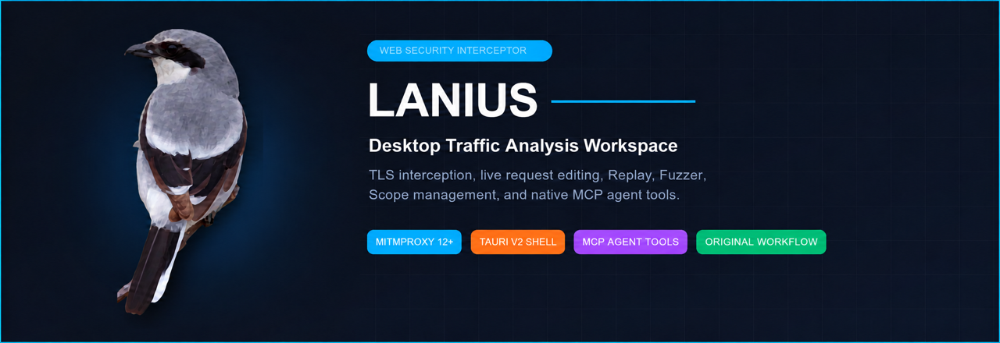
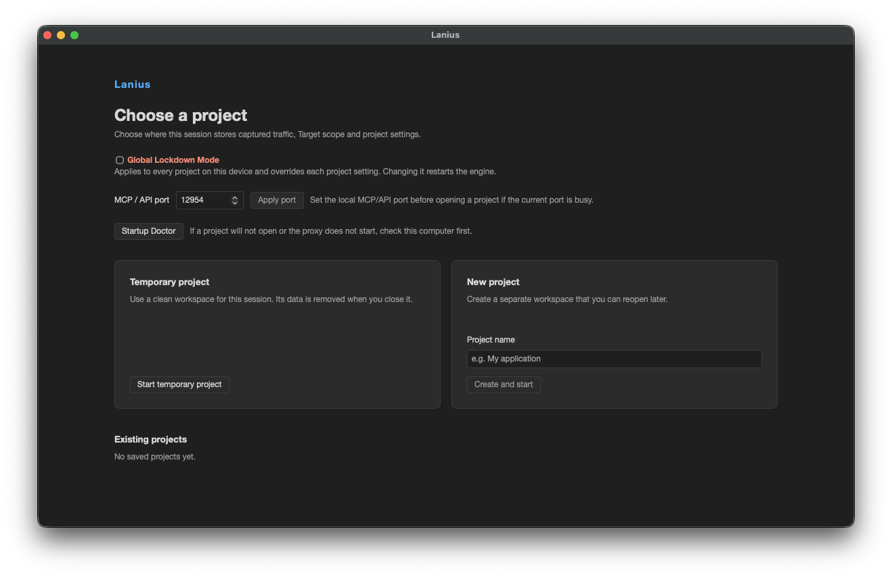
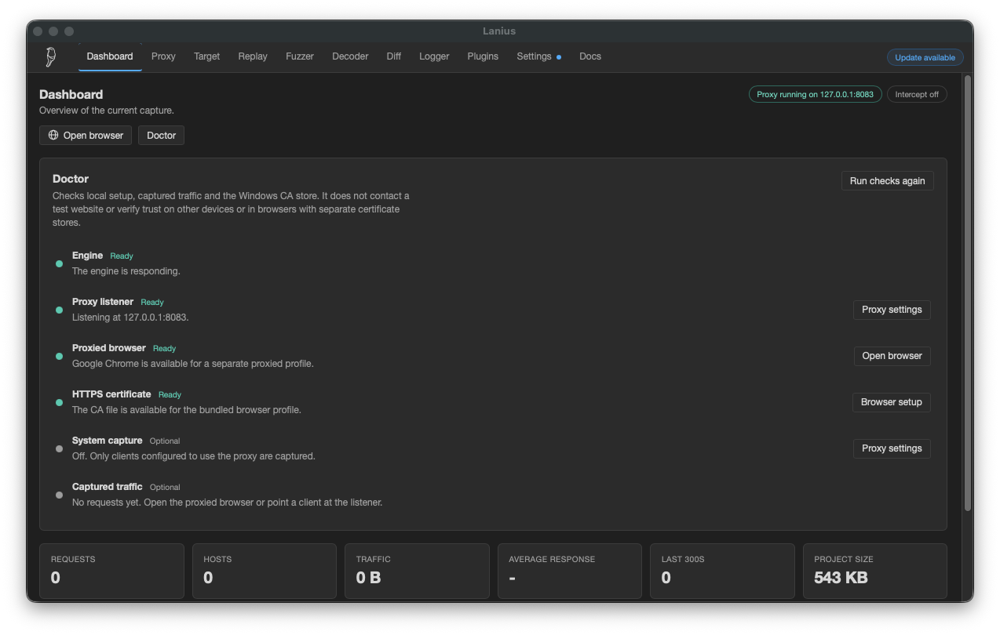
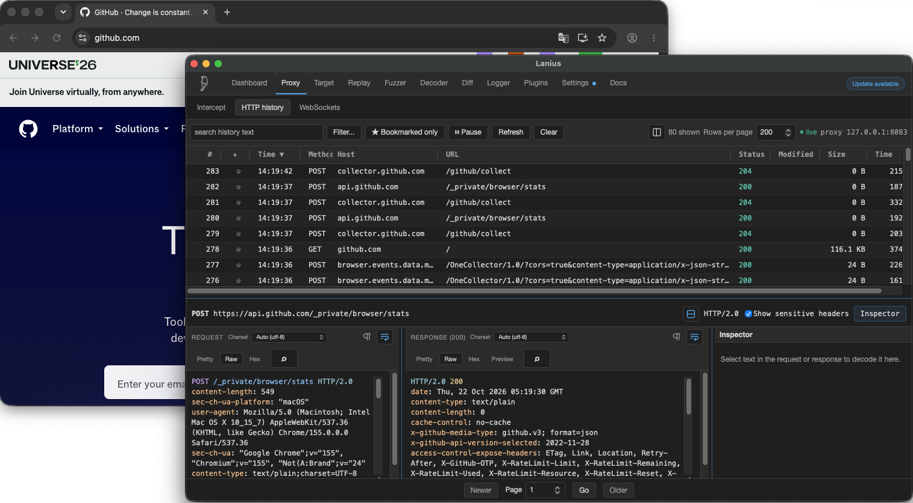
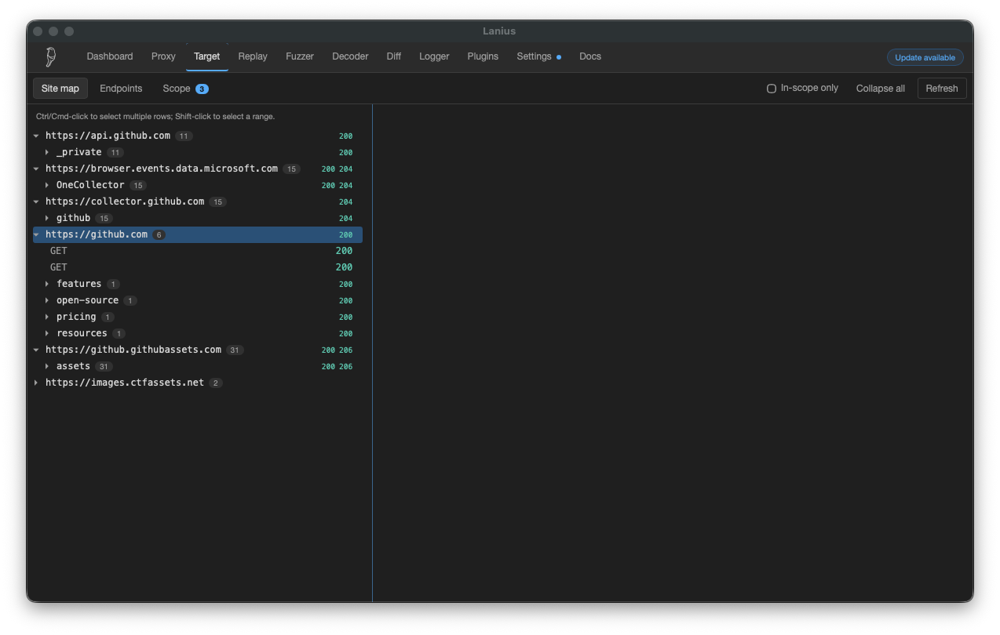
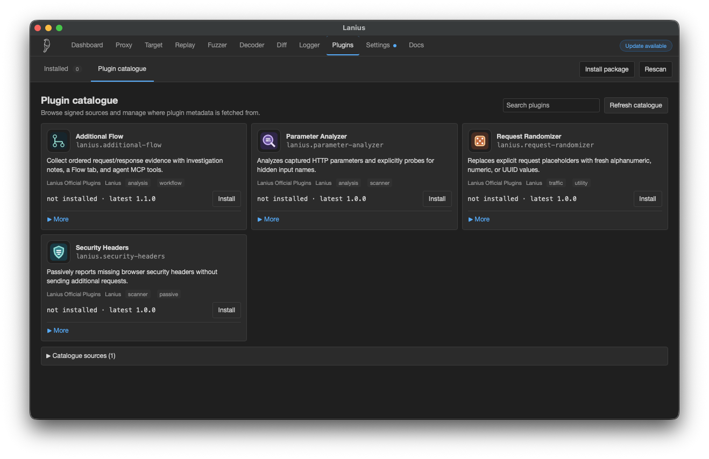
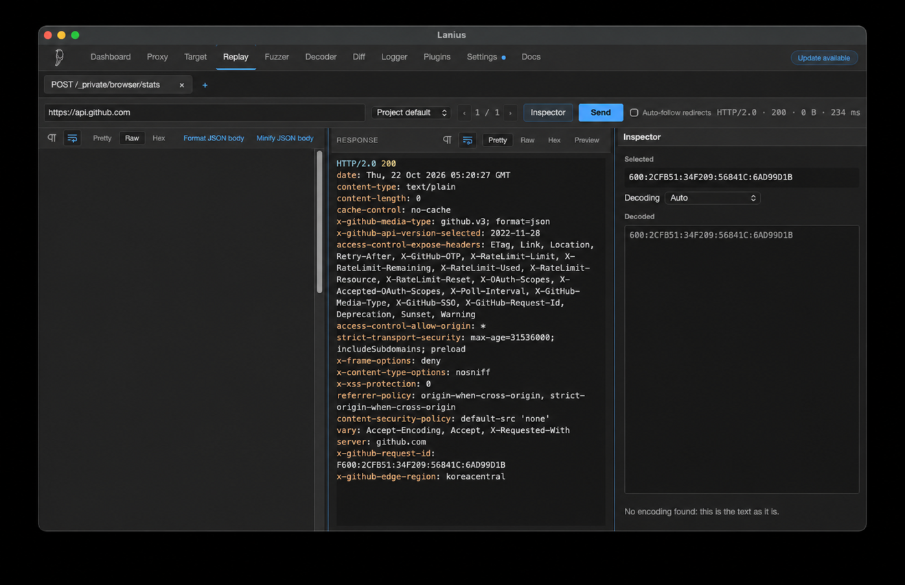
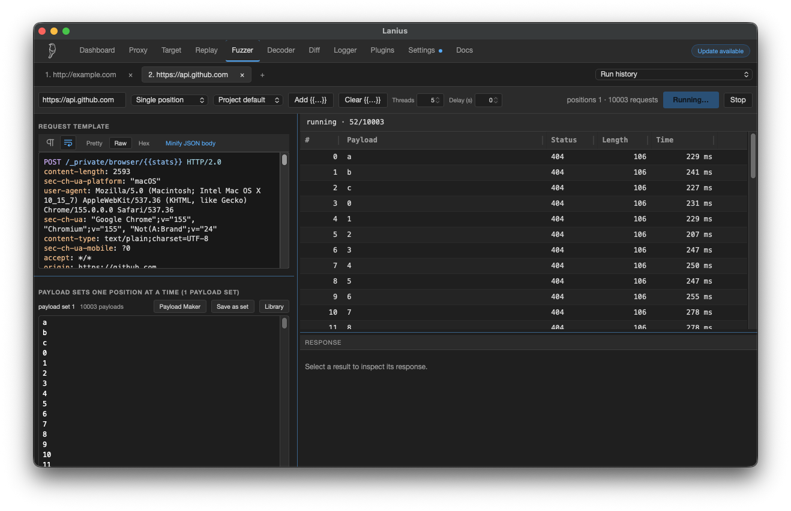
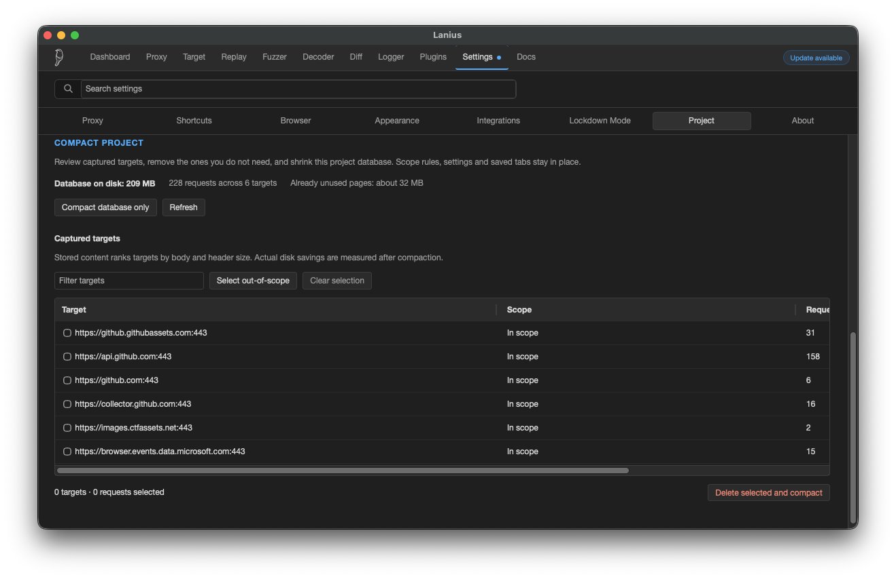

# Lanius

**The local-first web security workspace built for humans and AI agents.**

Powered by mitmproxy. Persistent projects, native MCP, and Lockdown Mode.

[Download](#download) · [Showcase](#showcase) · [Why Lanius](#why-lanius) · [Getting started](#getting-started) · [Docs](https://lanius.mir.sh/features)

---

Lanius sits between your browser and the web so you can see every request,
stop it mid flight, change it, and send it again. It is named after the shrike
(genus *Lanius*), a bird that ambushes its prey and pins it to a thorn.

Lanius embeds [mitmproxy](https://mitmproxy.org/) as its engine, so TLS
interception, HTTP/2 and WebSocket handling are battle tested. Its desktop
interface adds project-based capture, live editing, request replay, payload
fuzzing, encoding and decoding, diffs, plugins, and native MCP tools.

## Showcase

From first capture to focused testing, Lanius keeps the whole workflow in one
desktop workspace. Click any screenshot to open the matching guide, or visit
the [full showcase](https://lanius.mir.sh/showcase) for the guided tour.

<table>
  <tr>
    <td width="50%">
       
      <strong>Project workspaces</strong> 
      Keep captures, scope, settings, and saved tabs together—or start a disposable session.
    </td>
    <td width="50%">
       
      <strong>Built-in Doctor</strong> 
      Check the engine, listener, proxied browser, HTTPS certificate, and capture status at a glance.
    </td>
  </tr>
  <tr>
    <td width="50%">
       
      <strong>Live HTTP history</strong> 
      Browse through the proxy and inspect captured requests and responses as they arrive.
    </td>
    <td width="50%">
       
      <strong>Attack-surface map</strong> 
      Turn captured hosts, paths, methods, and status codes into a navigable site map.
    </td>
  </tr>
  <tr>
    <td width="50%">
       
      <strong>Signed plugins</strong> 
      Discover and manage extensions for analysis, automation, and reporting.
    </td>
    <td width="50%">
       
      <strong>Replay and inspect</strong> 
      Edit captured requests, resend them, follow redirects, and compare responses. Request data is redacted here.
    </td>
  </tr>
  <tr>
    <td width="50%">
       
      <strong>Payload fuzzing</strong> 
      Mark insertion points, run payload sets, and spot response outliers in live results.
    </td>
    <td width="50%">
       
      <strong>Project cleanup</strong> 
      See what consumes space, remove unneeded targets, and compact the project database.
    </td>
  </tr>
</table>

## Why Lanius

The established tools are good at different things. Lanius brings their most
useful day-to-day ideas into one local desktop workflow, then adds first-class
agent access and explicit controls for sensitive networks.

| Compared with | The Lanius difference |
|---|---|
| **mitmproxy** | **Same proven engine. Far less assembly required.** |
| **Burp Suite Community Edition** | **Persistent projects and unrestricted payload fuzzing—without upgrading to Pro.** |
| **OWASP ZAP** | **A focused manual testing workspace, built for human–agent collaboration.** |
| **Caido Basic** | **Native MCP. No account required. Lockdown built for sensitive networks.** |

### Access

| Capability | Lanius | mitmproxy / mitmweb | Burp Community | OWASP ZAP | Caido Basic |
|---|:---:|:---:|:---:|:---:|:---:|
| **Free** | **✓** | ✓ | △ | ✓ | △ |
| **Open source** | **✓** | ✓ | ✕ | ✓ | ✕ |

### Everyday workflow

| Capability | Lanius | mitmproxy / mitmweb | Burp Community | OWASP ZAP | Caido Basic |
|---|:---:|:---:|:---:|:---:|:---:|
| One-click proxy-ready browser | ✓ | ✕ | ✓ | ✓ | ✓ |
| Request and response intercept | ✓ | ✓ | ✓ | ✓ | ✓ |
| Scope and site map UI | ✓ | △ | ✓ | ✓ | ✓ |
| Request replay | ✓ | ✓ | ✓ | ✓ | ✓ |
| Unrestricted GUI fuzzing | ✓ | ✕ | △ | ✓ | ✓ |
| WebSocket intercept and resend | ✓ | △ | ✓ | ✓ | ✓ |
| GUI Match & Replace | ✓ | △ | ✓ | △ | ✓ |
| Decoder and response diff | ✓ | △ | ✓ | △ | △ |
| Persistent projects | ✓ | △ | △ | ✓ | ✓ |
| Extension system | ✓ | ✓ | ✓ | ✓ | ✓ |

### Where Lanius stands apart

| Capability | Lanius | mitmproxy / mitmweb | Burp Community | OWASP ZAP | Caido Basic |
|---|:---:|:---:|:---:|:---:|:---:|
| Native desktop MCP | ✓ | ✕ | △ | △ | △ |
| First-party SDK for plugin-owned MCP tools | ✓ | ✕ | ✕ | △ | ✕ |
| Sensitive-header redaction for agent tools | ✓ | ✕ | ✕ | ✕ | ✕ |
| Sensitive-network Lockdown Mode | ✓ | ✕ | ✕ | ✕ | ✕ |
| GUI per-app or PID system capture | ✓ | △ | ✕ | ✕ | ✕ |
| Full integration Doctor | ✓ | ✕ | △ | ✕ | ✕ |
| Unlimited persistent projects at entry level | ✓ | ✕ | △ | ✓ | △ |
| No account required | ✓ | ✓ | ✓ | ✓ | ✕ |
| Direct Burp settings import | ✓ | ✕ | ✕ | ✕ | ✕ |

Comparison scope: publicly documented desktop capabilities and entry-level
editions as of 2026-11-02. ✓ means the capability is included as a first-party
feature in the compared edition. △ means limited or conditional: an account,
different edition, add-on, CLI, manual setup, or third-party component may be
required. ✕ means unavailable in the compared product. Verify current details
in the official documentation for
[mitmproxy](https://docs.mitmproxy.org/stable/),
[Burp Suite](https://portswigger.net/burp/documentation/desktop),
[OWASP ZAP](https://www.zaproxy.org/docs/), and
[Caido](https://docs.caido.io/). Pricing and plan limits can change; see the
[Burp edition comparison](https://portswigger.net/burp/communitydownload) and
[Caido pricing](https://www.caido.io/pricing/) for the current terms.

## Download

Grab the [latest stable release](https://github.com/mirusu400/Lanius/releases/latest)
or the [nightly build](https://github.com/mirusu400/Lanius/releases/tag/nightly),
which is rebuilt from every commit on `main` that passes CI.

| Platform | File |
|---|---|
| macOS (Apple Silicon) | `Lanius_*_aarch64.dmg` |
| macOS (Intel) | `Lanius_*_x64.dmg` |
| Linux | `Lanius_*_amd64.AppImage` or `Lanius_*_amd64.deb` |
| Windows | `Lanius_*_x64_en-US.msi` or `Lanius_*_x64-setup.exe` |

Builds are not code signed yet. On macOS, run
`xattr -dr com.apple.quarantine /Applications/Lanius.app` once after
installing. On Windows, choose **More info** then **Run anyway** at the
SmartScreen warning.

## Getting started

1. Open Lanius and choose a temporary or named project. The proxy starts on
   `127.0.0.1:8080`.
2. Click **Open browser** in the **Proxy** tab. A Chromium browser starts
   already proxied and trusting the CA, and requests appear live as you browse.

To use your own browser or capture other apps, see
[Settings](docs/settings.md). The in-app **Docs** tab and
[lanius.mir.sh](https://lanius.mir.sh/features) cover every feature in detail,
including [Plugins](docs/plugins-sdk.md), [AI agents](docs/ai-agents.md) and
[Lockdown Mode](docs/lockdown-mode.md).

## Building from source

You need Python 3.13+, Node 22 and a Rust toolchain. Build, check and release
instructions are in [DEVELOPMENT.md](DEVELOPMENT.md).

## Legal

Lanius is a tool for testing systems you are authorised to test. Confirming you
have permission is your responsibility.

 

